<div align="center">
  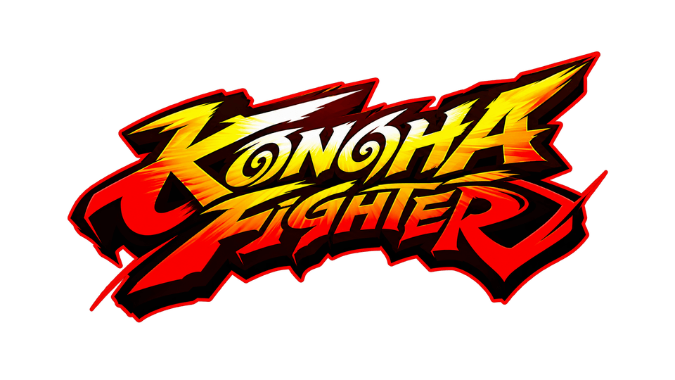

  <h1>Konoha Fighter</h1>

  <p><strong>A mobile-first 2D browser fighting game with deterministic combat, original pixel-art fighters, and retro arcade presentation.</strong></p>

  <p>
    
    
    
    
  </p>
</div>

---

<p align="center">
  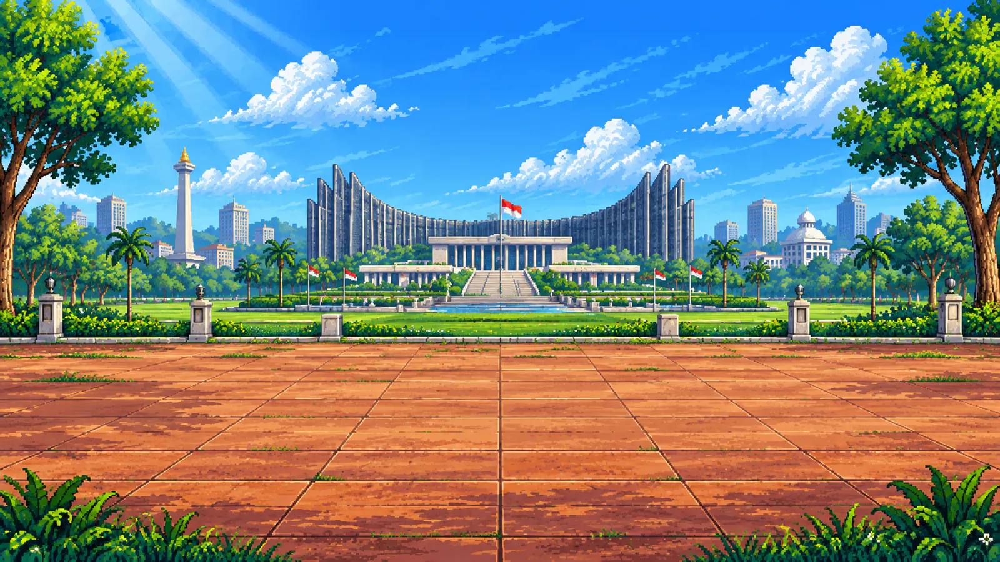
</p>

## About the game

Konoha Fighter is an offline local fighting game prototype that runs entirely in the browser. It combines a fixed-step combat simulation with a Phaser renderer, responsive landscape controls, animated pixel-art assets, character-specific skills, and a dedicated training mode.

The current build focuses on polished mobile play and deterministic combat foundations. Online rooms, server authority, prediction, and reconciliation are planned for a later milestone and are not part of this build.

## Fighters

<table>
  <tr>
    <th align="center">Mamang Grrovy</th>
    <th align="center">King Etanol</th>
    <th align="center">Bot Sawit</th>
  </tr>
  <tr>
    <td align="center">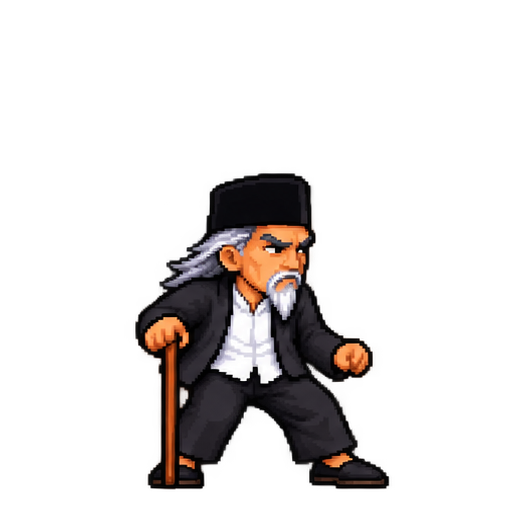</td>
    <td align="center">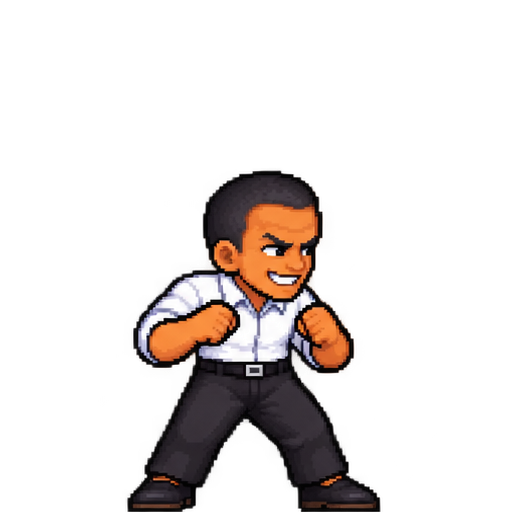</td>
    <td align="center"></td>
  </tr>
  <tr>
    <td><strong>The Staff Legend</strong><br>Controls space with charging boars, a long-range stun projectile, and a cinematic angelic lightning ultimate.</td>
    <td><strong>The Ethanol King</strong><br>Uses flame pressure, arena-wide Black Oil, and an unblockable Robot Tong laser transformation.</td>
    <td><strong>Training Target</strong><br>An immortal training dummy with hit reactions. An active CPU behavior system is documented in the roadmap.</td>
  </tr>
</table>

## Skill showcase

<table>
  <tr>
    <td align="center">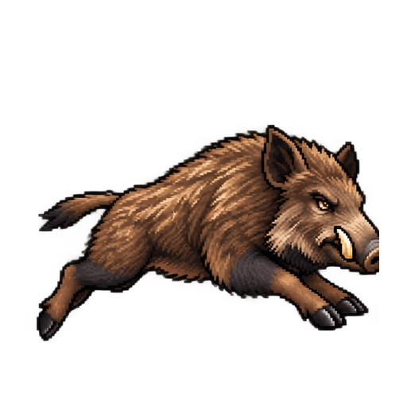<br><strong>Boar Charge</strong></td>
    <td align="center">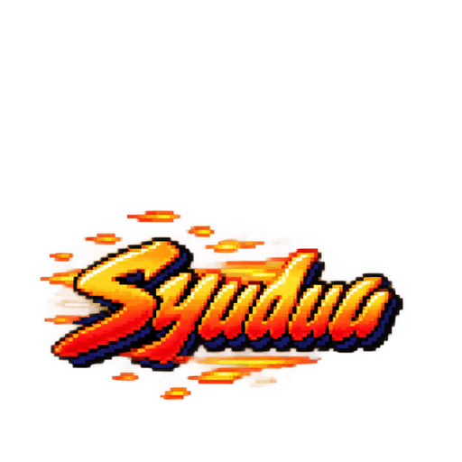<br><strong>Shuuu Projectile</strong></td>
    <td align="center">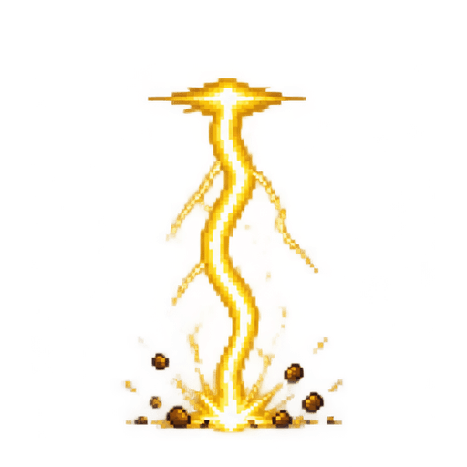<br><strong>Angelic Lightning</strong></td>
    <td align="center"><br><strong>Ethanol Flame</strong></td>
    <td align="center">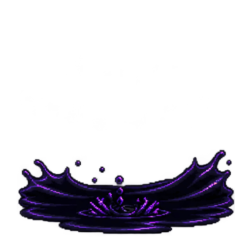<br><strong>Black Oil</strong></td>
    <td align="center"><br><strong>Robot Tong Laser</strong></td>
  </tr>
</table>

## Current features

### Combat

- Deterministic fixed-step simulation at 60 Hz.
- Ground movement, jumping, crouching, blocking, knockdowns, recovery, stun, root, and slow effects.
- Standing, jumping, and crouching variants for punches and kicks.
- Character-specific basic, normal, and ultimate skills.
- Mamang Grrovy's `Punch → Punch → Kick` combo route.
- Startup, active, and recovery frames for every attack.
- Energy costs, cooldowns, hit stun, block stun, knockback, and damage rules.
- 160 HP, 100 maximum energy, 75-second rounds, and first-to-two round wins.
- Debug rendering for hurtboxes, pushboxes, and active hitboxes.

### Game modes and screens

- Local two-player versus mode.
- Training mode with unlimited time, full energy, no skill cooldowns, and an immortal Bot Sawit target.
- Animated main menu, character selection, VS loading screen, battle arena, result screen, and Sprite Lab.
- Real asset preloading before the arena starts.
- Animated K.O. presentation and combat feedback.

### Mobile experience

- Landscape-first, single-frame layout with no page scrolling.
- Portrait orientation notice with a rotate-device animation.
- iPhone Safari visual viewport support and safe-area handling.
- Touch analog movement; up jumps and down crouches.
- Animated Punch, Kick, DEF, and three skill buttons.
- Custom control positions with drag-and-drop editing.
- Standard, Compact, and Mirror control presets.
- Adjustable control scale.
- Fullscreen and landscape orientation requests when supported by the browser.
- Double-tap zoom and gesture protection for touch gameplay.

### Audio and settings

- Master, sound-effect, and background-music volume controls.
- Global mute and background-music toggles.
- Lightweight procedural retro background music.
- Persistent settings stored on the player's device.
- Built-in sound test and control-layout preview.

### Asset tooling

- Source sheets and optimized public assets are stored separately.
- Automated sprite normalization to a consistent 512 × 512 canvas and baseline.
- Palette-compressed PNG animation frames and compressed WebP stage art.
- Validation for sprite boundaries, transparent margins, frame counts, and output size.
- Dedicated pipelines for character sprites, VFX, skill emblems, mobile controls, and retro UI panels.

## Character skills and balance

| Fighter | Tier | Skill | Energy | Cooldown | Effect |
|---|---|---|---:|---:|---|
| Mamang Grrovy | Basic | Boar Charge | 30 | 5 s | Summons six charging boars that knock the opponent down. |
| Mamang Grrovy | Normal | Shuuu Projectile | 55 | 9 s | Long-range projectile, 22 damage, and a one-second stun. It can be blocked before impact. |
| Mamang Grrovy | Ultimate | Angelic Decree | 100 | 18 s | Darkens the arena, locks the target, summons five angels, and strikes for 42 damage. |
| King Etanol | Basic | Ethanol Flame | 30 | 5 s | Fires an extended flame jet that can hit up to three times. |
| King Etanol | Normal | Black Oil | 55 | 9 s | Covers the arena floor, deals 14 damage, roots for 0.6 seconds, and slows for three seconds. |
| King Etanol | Ultimate | Robot Tong | 100 | 18 s | Transforms King into a barrel robot and fires an unblockable 40-damage knockdown laser. |

These are prototype balance values centralized in [`packages/game-core/src/index.ts`](packages/game-core/src/index.ts). The simulation determines damage and hit results; sprite frames only render the resulting state.

## Getting started

### Requirements

- Node.js 22 or newer is recommended.
- npm is required for workspace and script management.

### Installation

```bash
git clone <your-repository-url>
cd KONOHA-FIGHTER
npm install
```

### Start the development server

```bash
npm run dev
```

Open the local URL printed by Vite. To test on a phone, open the network URL from a device on the same network and rotate the device to landscape.

### Production build

```bash
npm run build
```

The build command validates all character, VFX, and UI assets before compiling the web application.

## Controls

### Keyboard

| Action | Player 1 | Player 2 |
|---|---|---|
| Move | `A` / `D` | `←` / `→` |
| Jump / crouch | `W` / `S` | `↑` / `↓` |
| Punch / kick | `J` / `K` | `Numpad 1` / `Numpad 2` |
| Basic / normal / ultimate | `L` / `I` / `O` | `Numpad 3` / `Numpad 4` / `Numpad 5` |
| Hold DEF | `U` | `Numpad 0` |
| Pause | `Esc` | `Esc` |
| Hitbox debug | `H` | `H` |

The number-row equivalents `0` through `5` are also supported for Player 2.

### Touch controls

- Drag the analog left or right to move.
- Push the analog upward to jump.
- Push the analog downward to crouch.
- Use Punch and Kick while standing, jumping, or crouching.
- Hold DEF to block normal incoming attacks.
- Use S1, S2, and S3 when enough energy is available.
- Open Settings to move, mirror, resize, or reset the control layout.

<p align="center">
  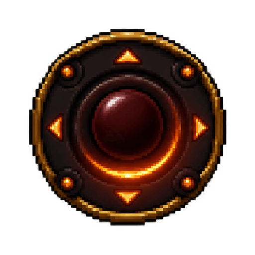
  &nbsp;&nbsp;
  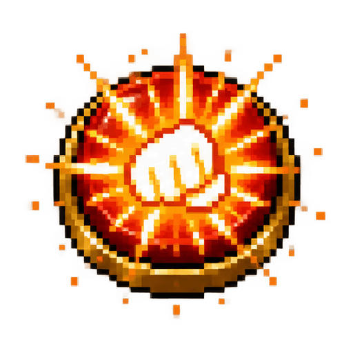
  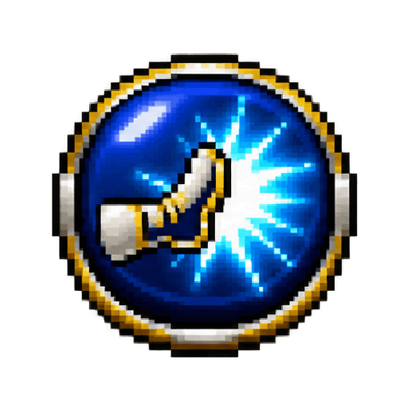
  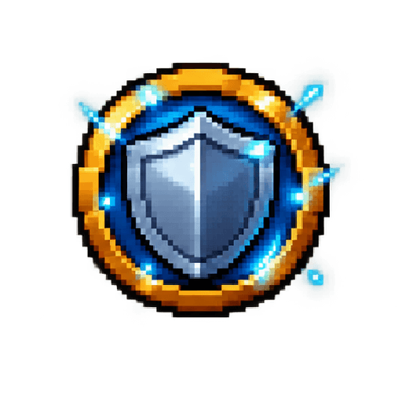
</p>

## Available scripts

| Command | Purpose |
|---|---|
| `npm run dev` | Start the Vite development server. |
| `npm run build` | Validate assets, type-check, and create a production build. |
| `npm run typecheck` | Type-check the game core and web client. |
| `npm test` | Run deterministic combat tests. |
| `npm run assets:build` | Rebuild every character, VFX, and UI asset. |
| `npm run sprites:build` | Build normalized character sprite frames. |
| `npm run sprites:validate` | Validate character and training-dummy frames. |
| `npm run vfx:build` | Build all visual-effect frames. |
| `npm run vfx:validate` | Validate all VFX output. |
| `npm run ui:build` | Build and optimize UI animations, emblems, and retro panels. |
| `npm run ui:validate` | Validate UI animation output and compressed theme assets. |

## Project structure

```text
KONOHA-FIGHTER/
├── apps/
│   └── web/                    # Phaser renderer, responsive UI, and public runtime assets
├── packages/
│   └── game-core/              # Deterministic combat rules, state, and tests
├── assets/
│   ├── characters/             # Character source sheets
│   ├── stages/                 # Original stage sources
│   ├── ui/                     # UI, logo, control, and skill-emblem sources
│   └── vfx/                    # Skill-effect source sheets
├── tools/
│   ├── sprite-pipeline/        # Character slicing, cleanup, normalization, and validation
│   ├── ui-pipeline/            # UI generation, compression, and validation
│   └── vfx-pipeline/           # VFX slicing, compression, and validation
├── docs/
│   └── TRAINING-BOT-PLAN.md    # Planned active training CPU design
└── package.json                # Workspace scripts
```

## Architecture

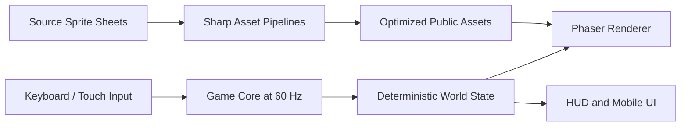

### Game core

[`packages/game-core`](packages/game-core) contains combat state, character data, collision boxes, skill effects, round rules, and the fixed-tick simulation. It has no DOM or Phaser dependency, which keeps combat logic testable and prepares it for future server execution.

### Web client

[`apps/web`](apps/web) uses Phaser for the arena and character rendering. Standard DOM and CSS layers provide menus, loading screens, the HUD, touch controls, settings, orientation handling, and responsive iPhone Safari support.

### Asset pipeline

The source artwork under [`assets`](assets) is converted into optimized runtime files under [`apps/web/public/assets`](apps/web/public/assets). Each pipeline can rebuild and validate its own output independently.

## Testing

The current suite contains 25 deterministic combat tests covering:

- Active-frame collision and single-hit enforcement.
- Blocking and block damage prevention.
- Round wins, K.O. flow, and match completion.
- Boar Charge, Ethanol Flame, Shuuu stun, Angelic Decree, Black Oil, and Robot Tong.
- Skill energy, cooldowns, knockdowns, stun duration, root, and slow behavior.
- Air and crouching attacks.
- Mamang Grrovy's three-hit combo.
- Training-mode immortality, full energy, and cooldown removal.
- Reproducible outcomes from identical input sequences.

Run all checks before submitting a change:

```bash
npm run typecheck
npm test
npm run build
```

## Training CPU roadmap

Bot Sawit currently acts as an immortal reaction dummy. The approved active-CPU design is documented in [`docs/TRAINING-BOT-PLAN.md`](docs/TRAINING-BOT-PLAN.md) and includes:

- Idle, defensive, combo-practice, and active-CPU behaviors.
- Beginner, Normal, and Hard reaction profiles.
- Character-specific combo and skill decisions.
- Fair reaction delay, intentional mistakes, and no future-input reading.
- Training settings, input history, position reset, recording, and playback.
- Seeded deterministic decisions for future server-authoritative matches.

## Roadmap

- Implement the active Bot Sawit training CPU.
- Add more playable fighters and stages.
- Expand transitional animation frames for every move.
- Add remappable keyboard controls and gamepad support.
- Add damage, combo, and frame-data panels to training mode.
- Move authoritative simulation to a server process.
- Add online rooms, matchmaking, input prediction, reconciliation, and replay verification.
- Profile and split the production JavaScript bundle.

## Project status

This repository is a playable offline prototype. It is suitable for local testing, mobile-control iteration, combat balancing, and asset-pipeline development. Competitive online networking is still under development.

No license file is currently included. Add a license before distributing the project or accepting external contributions.

---

<p align="center">
  
  <br>
  <strong>Choose your fighter and enter the arena.</strong>
</p>
